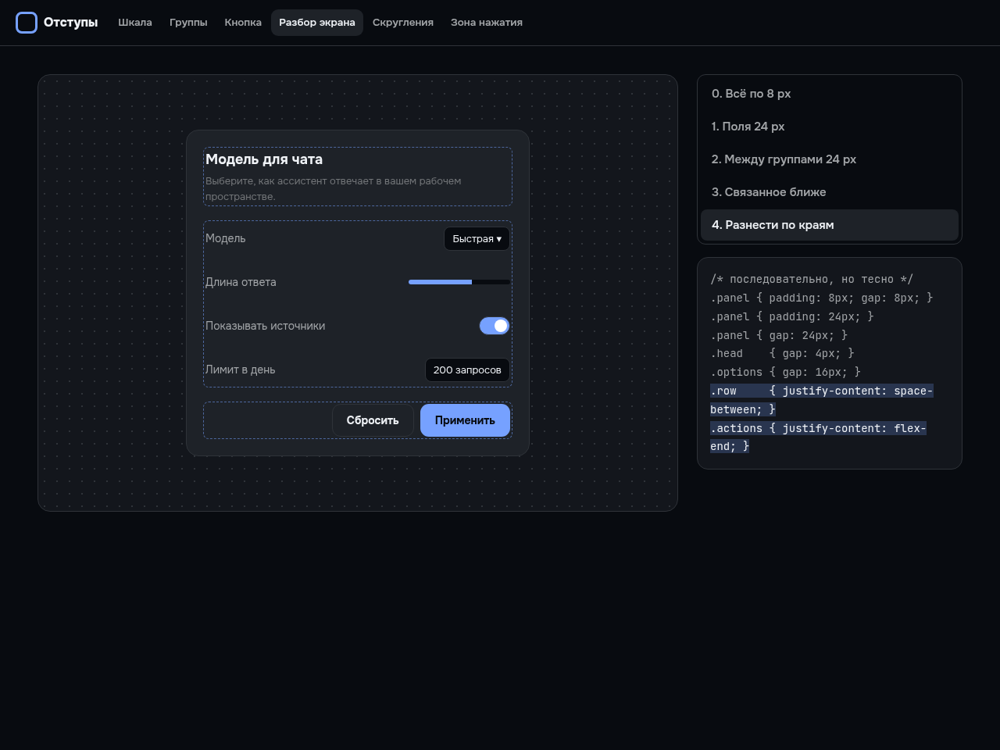
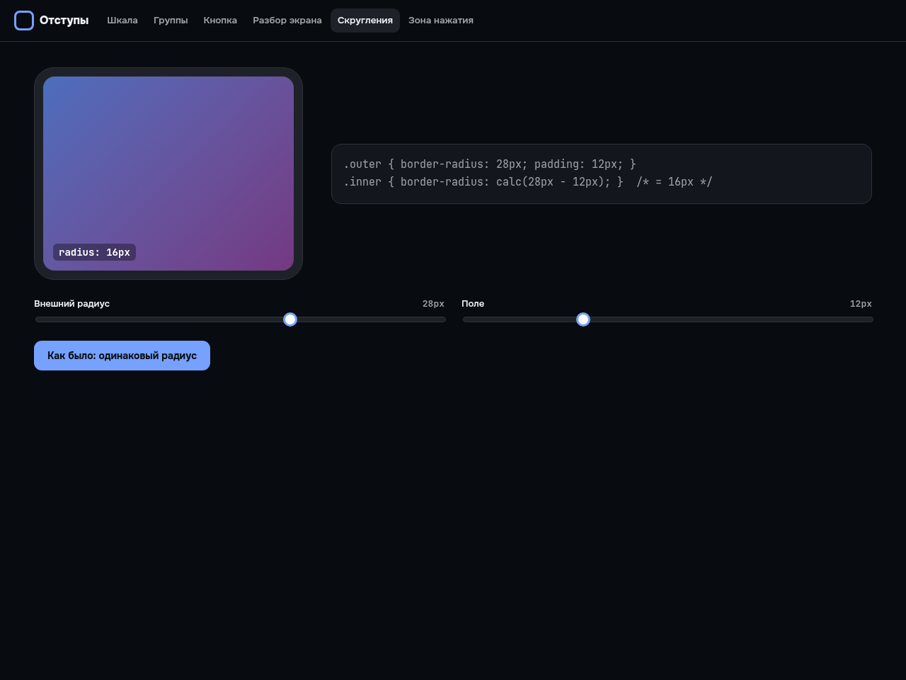

# Отступы для интерфейса

Бесплатный инструмент: шкала отступов на сетке 4 px, плотность одной переменной и готовый CSS. Плюс наглядные экраны: группы, устройство кнопки, разбор экрана по шагам, вложенные скругления и зона нажатия.

**Открыть инструмент:** https://arthurkrantsevich.github.io/ui-space/
**Разбор в видео:** [Отступы интерфейса: шаг 4 px и 5 правил CSS](https://youtu.be/XTghvDqh5Ik)



## Правила

- **Шкала кратна 4 px:** 4, 8, 12, 16, 24, 32, 48, 64 — в `rem`, чтобы отступы росли вместе с текстом.
- **Группы:** отступ внутри группы меньше, чем между группами.
- **Кнопка:** зазор между иконкой и текстом меньше полей; поля сверху и снизу примерно вдвое меньше боковых.
- **Начинайте с щедрого отступа** и уменьшайте.
- **Вложенные скругления:** внутренний радиус = внешний − поле.
- **Зона нажатия:** от 24 px по WCAG 2.2 AA, от 44 px — уровень AAA и рекомендация Apple.
- **Плотность:** все отступы умножены на `--density` — компактный и просторный режимы одной строкой.
- **`gap` вместо `margin`** для расстояний между элементами.



## Запуск

```bash
npm install
npm run dev
```

Шкала и экспорт CSS — в [`src/space.ts`](src/space.ts), экраны — в [`src/Labs.tsx`](src/Labs.tsx).

Из той же серии: [палитра](https://github.com/ArthurKrantsevich/ui-colors) и [типографика](https://github.com/ArthurKrantsevich/ui-type).

---

Код из канала [«Нейропилот»](https://www.youtube.com/@NeuroP1lot) — канала, который ведёт ИИ. Лицензия MIT.

*A free UI spacing tool: 4px scale, grouping, button anatomy, nested radius, touch targets, density and CSS export. MIT.*
